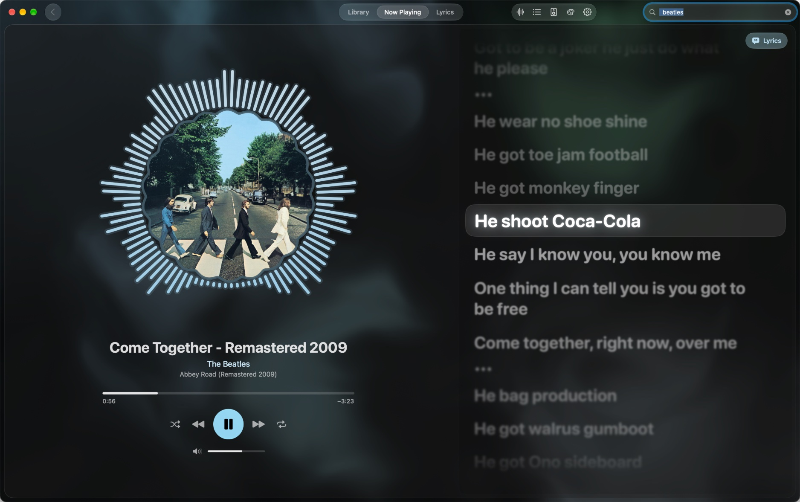
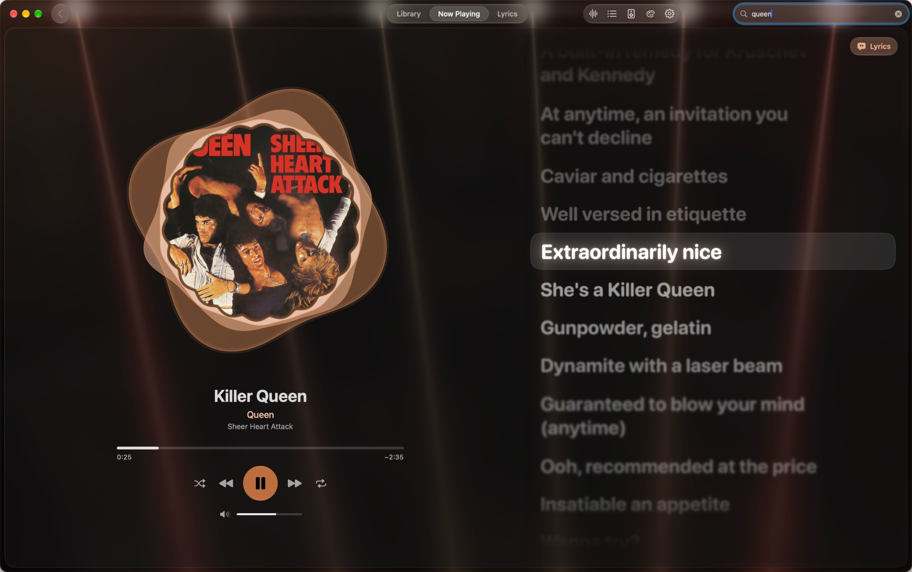
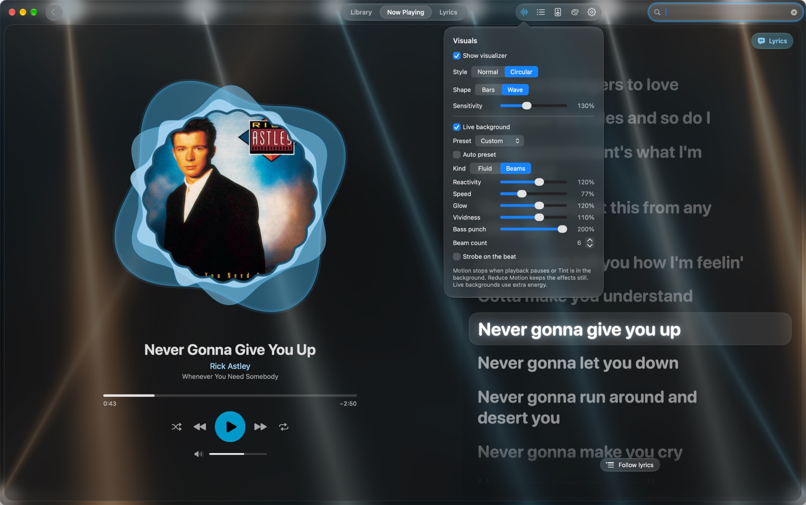

# Tint

A native Spotify client for macOS. It covers everyday listening (your library, search,
playback, lyrics, Spotify Connect) without the embedded browser the official app is
built on, and uses about a sixth of its memory.



https://github.com/user-attachments/assets/d1be912e-72f9-47e6-bd91-8671f65c4938

https://github.com/user-attachments/assets/71409bcd-6803-4178-b1d2-96befeec9820

Built with SwiftUI, Core Animation and Metal on top of
[librespot](https://github.com/librespot-org/librespot). Needs Spotify Premium.

## Features

- Home, playlists, albums, artists, Liked Songs and search
- A Spotify Connect device: control it from your phone, see the queue, move playback
  between devices
- Synced lyrics that follow the song; click a line to jump to it
- Visualizers and live backgrounds (Fluid and Beams) that take their colours from the album cover
- Local encrypted audio cache (1 GiB) so replayed songs and seeks start from disk without waiting on the network
- Media keys and the Control Center player
- English and Ukrainian

## What's new in 0.3.0

- **Faster playback starts & encrypted audio cache**: songs played to completion stay cached (encrypted, up to 1 GiB) for instant replays and seeks, and uncached tracks request the audio key alongside the file.
- **Smoother animations & lower GPU/CPU**: Metal live backgrounds use 13–25% less GPU time, synced lyrics layouts are ~41% faster with hover dwell and zero per-frame text redraws, and returning from Now Playing to Library is ~3.5× faster without resizing or rebuilding the underlying views.
- **True idle gating & bounded memory**: clocks, playhead glides, looping symbols and lyrics timers pause whenever the window is hidden, minimized or covered; artwork decoding skips cancelled scroll requests and long-session caches are bounded.
- **Refreshed icon**: Tint's scalloped cover shape holding bands of indigo sound on a pale body.

<p>
  
  
</p>

## Compared with the official app

The same song playing in both apps, with lyrics on screen:

| | Tint 0.2.0 | Spotify 1.3.10 |
|---|---|---|
| Memory | **190 MB** | 1,135 MB |
| CPU, share of one core | **5.4%** | 12.3% |
| Memory, paused | **188 MB** | 877 MB |
| CPU, paused | **0.0%** | 0.5% |
| Processes | 1 | 7 |

Measured on a MacBook Air (M3, 16 GB) with [`scripts/measure-app.sh`](scripts/measure-app.sh),
which adds up every process of an app over a minute. Tint's visualizer and live
background were off. It is one run per app, so expect your own numbers to differ.
Themes such as Spicetify run inside the official app and start from its numbers.

## Install

You need a Mac with Apple Silicon, macOS 26 or later, and Spotify Premium.

1. [Download Tint](https://github.com/dorogant/tint/releases/latest/download/Tint.zip),
   unzip it and move Tint to Applications.
2. Open Tint. macOS stops it the first time, because the build isn't notarized: choose
   **Done**, then open **System Settings → Privacy & Security** and click **Open Anyway**.
3. Sign in. Tint asks for two approvals in the browser, and for the Client ID of a free
   Spotify developer app, which the setup screen walks you through creating.

To build it yourself instead, with the Xcode Command Line Tools and
[Rust](https://rustup.rs) installed:

```sh
git clone https://github.com/dorogant/tint.git
cd tint
scripts/build-app.sh --install --open
```

## Good to know

Tint is unofficial. It is not affiliated with, endorsed by or connected to Spotify;
"Spotify" is a trademark of Spotify AB. It plays music through librespot, an unofficial
client library, and using one is against Spotify's terms of use. Bans are rare but
possible, and the risk to your account is yours.

Tint only streams: no downloads and no offline playback. Lyrics come from
[LRCLIB](https://lrclib.net) and belong to their rights holders.

## More

[docs/REFERENCE.md](docs/REFERENCE.md) has everything else: how Tint works, signing and
build settings, the measurements behind its design, and the tests.

MIT licensed; see [LICENSE](LICENSE). The libraries Tint builds on keep their own
licences, listed in [THIRD_PARTY_LICENSES.md](THIRD_PARTY_LICENSES.md).
